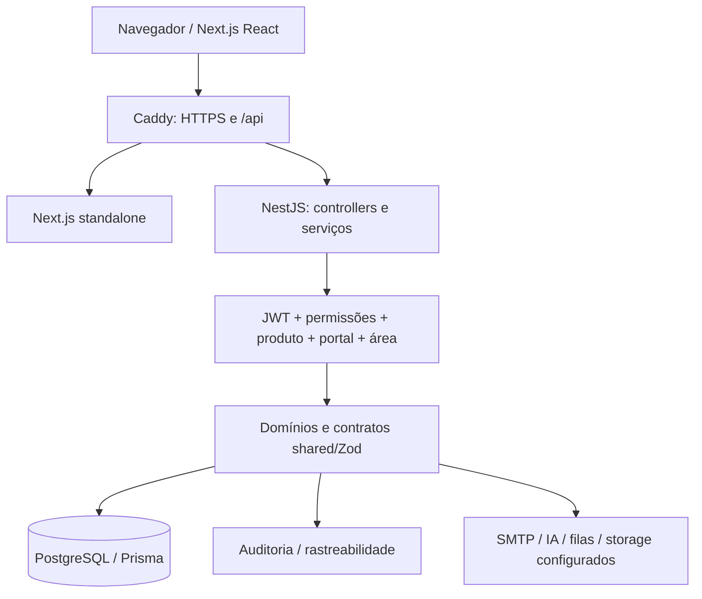
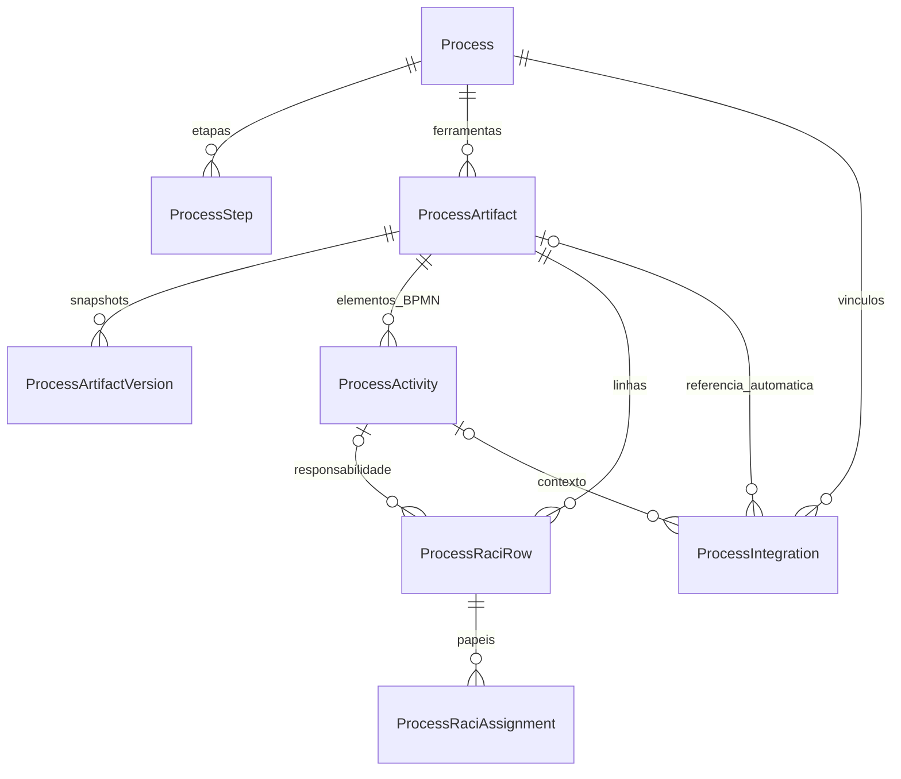

# Arquitetura e integrações do Gestão 360

Referência: árvore local de 16/11/2026. Leia junto à [memória operacional](CODEX_MEMORIA_OPERACIONAL.md) e ao [inventário](INVENTARIO_ROTAS_CODIGO.md).

## Componentes

`apps/web` usa App Router, TanStack Query para cache/mutações e primitivas Radix/Tailwind. `apps/api` aplica injeção de dependências, PrismaService e guardas globais. `packages/shared` concentra contratos e regras estáveis como farol, progresso de projeto e consistência RACI. Não há duplicação do cadastro empresarial entre as três ferramentas.

## Fonte de verdade por domínio

| Domínio | Fonte persistente | Relação principal |
|---|---|---|
| Empresa e acesso | Company, User, Permission, AccessProfile | Empresa efetiva da sessão; regras por área |
| Organização | OrgNode, Branch, OrgJob, OrgEmployee | Pessoas, áreas e cargos existentes |
| Estratégia | StrategicMap, Perspective, StrategicObjective | Objetivos ligados a áreas/indicadores |
| Indicadores | Indicator, IndicatorTarget, IndicatorResult | Período, meta, realizado, aprovação |
| Melhoria | Deviation, TreatmentCase, ActionPlan, ActionTask | Causa, plano, evidência, eficácia |
| Projetos | Project, ProjectTask, ProjectMilestone, ProjectProgressSnapshot | Cronograma e avanço real diário |
| Reuniões | Meeting e entidades mensais | Decisões e acompanhamentos |
| Trabalho pessoal | WorkspaceTask / fontes + WorkItemIndex | Índice consulta originais; não substitui dados |
| Processos | Process, ProcessStep | Raiz compartilhada de SIPOC/BPMN/RACI |
| Governança de processos | ProcessArtifact / ProcessArtifactVersion | Estado atual e snapshots de cada alteração |

## Modelo aditivo de processos

ProcessArtifact identifica tipo, cenário, estado, revisão e versão. SIPOC guarda JSON validado; BPMN guarda XML padrão; RACI usa linhas/atribuições relacionais e snapshots. ProcessActivity usa chave única `(artifactId, elementId)`. Uma atividade removida é inativada, preservando a referência; uma reimportada recupera a mesma identidade.

ProcessIntegration possui FKs tipadas para os destinos existentes e um CHECK exige exatamente um destino. `scopeKey` distingue processo, atividade ou referências mantidas por artefato. O banco valida essa coerência; o serviço valida empresa, módulo, permissão, área e pertença da atividade ao processo. RACI também exige um único sujeito por atribuição e no máximo um registro relacionado por linha.

Atualizações de artefato bloqueiam sua linha com `FOR UPDATE` e conferem `revision`. Em seguida gravam conteúdo, atividades/atribuições, snapshot, AuditLog e TraceabilityEvent na mesma transação. Falha em qualquer etapa reverte toda a operação. Não existem APIs de update/delete de snapshots. Histórico preserva autor nominal e contexto mesmo com mudanças posteriores nas relações vivas.

## Contrato HTTP de processos

Prefixo `/api/processes`; exige módulo disponível e permissões declaradas.

| Operação | Método/caminho | Autorização principal |
|---|---|---|
| Cadastro/lista/etapas | Rotas existentes do controller Processes | view/create/update/delete + área |
| Contexto integrado | GET `/:id/context` | view + área do processo |
| Painel | GET `/governance/dashboard` | view; destinos filtrados separadamente |
| Destinos/participantes | GET `/governance/targets`, `/subjects` | view; referências respeitam módulos próprios |
| Navegação reversa | GET `/governance/related?type=&targetId=` | view e acesso ao destino |
| Criar artefato | POST `/:id/artifacts` | update + área |
| Ler/salvar artefato | GET/PATCH `/governance/artifacts/:id` | view/update + área |
| Decisões | POST `/governance/artifacts/:id/transition` | update/approve/publish/delete conforme ação |
| Histórico | GET `/governance/artifacts/:id/versions[?before=N]` | view; lotes de 100 |
| Snapshot | GET `/governance/artifacts/:id/versions/:versionId` | view no artefato/processo |
| Comparação | GET `/governance/artifacts/:id/compare/:otherId` | view nos dois BPMNs do mesmo processo |
| Propriedade de atividade | PATCH `/governance/activities/:id` | update; rascunho e revisão atual |
| Criar/remover vínculo | POST `/:id/integrations`, DELETE `/governance/integrations/:id` | update; atividade em rascunho |
| Pré-validar XML | POST `/governance/validate-bpmn` | update; limites/validação de XML |

Vínculos automáticos de SIPOC/RACI são mantidos ao salvar o conteúdo de origem. Sua remoção isolada é recusada para evitar divergência entre conteúdo e relacionamentos. A remoção de um vínculo manual não apaga o registro de destino.

## Integrações e proteção de dados

Cada tipo de destino define modelo, FK, módulo, permissão e política de área em ProcessLinksService. Seleções retornam nomes/rotas mínimos e resultados de indicador quando autorizados. Vínculos indisponíveis não revelam os dados do destino. RACI não abre acesso a projetos/documentos nem transfere privilégios.

Pendências de processo reutilizam o coletor de Meu Dia e `PROCESS_REVIEW`. Envio para revisão notifica o proprietário quando diferente do autor. Não se cria tarefa de execução a partir de cada símbolo BPMN. Projetos e tarefas existentes mantêm suas próprias regras, status e métricas.

GED, formulários, risco, auditoria e treinamento têm destinos tipados preparados e FKs reais. O escopo atual mantém esses módulos suspensos, inclusive para Super Admin nas rotas bloqueadas pelo produto. Não existem telas simuladas para contornar a suspensão.

## Infraestrutura e limites

Runtime em Docker Compose na Vultr; Postgres local e armazenamento persistente do produto. Caddy encaminha `/api` à API e as páginas ao Next. `NEXT_PUBLIC_API_URL=/api` é incorporado ao build. O navegador de teste usa encaminhamento equivalente em uma rede Docker descartável; não substitui o proxy em produção.

Nenhum motor BPMN novo. Nome/documentação de elementos não executam scripts; importações externas/DTD/entidades são rejeitadas. Diagramas de até 2 MB e 5.000 elementos são limitados também pela validação estrutural geral da API. O modelador mantém a atribuição exigida por sua licença. Datas de revisão são datas de calendário representadas de forma consistente pela interface; medições de projetos usam São Paulo.
