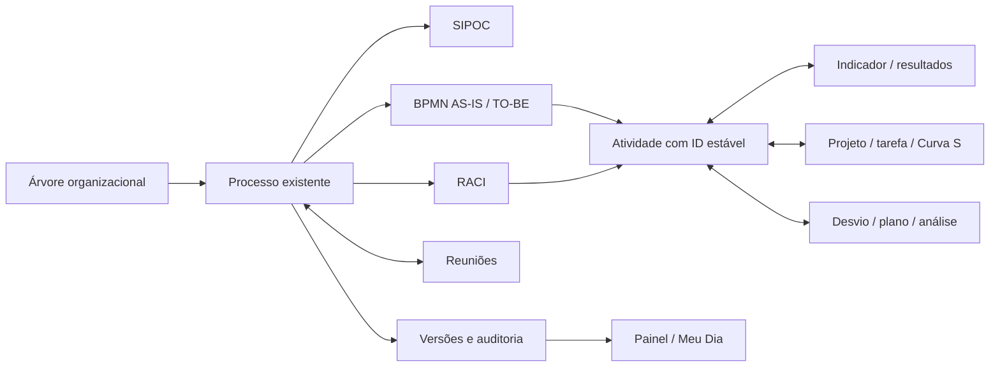

# Gestão 360 — documentação completa

Referência: 16/11/2026. Base: código local sobre `57aeed6`, incluindo a implementação SIPOC/BPMN/RACI. Este documento descreve a implementação; **a nova funcionalidade ainda depende de publicação e da migration em produção**. Não confundir código disponível, módulo ativo no produto, licença da empresa e versão efetivamente publicada.

Leitura complementar: [mapa funcional](MAPA_FUNCIONALIDADES.md), [inventário de rotas e entidades](INVENTARIO_ROTAS_CODIGO.md), [arquitetura](ARQUITETURA_E_INTEGRACOES.md), [manual](MANUAL_DO_USUARIO.md), [guia técnico](GUIA_TECNICO.md), [visão comercial](VISAO_COMERCIAL_GESTAO360.md) e [relatório desta implementação](RELATORIO_IMPLEMENTACAO_SIPOC_BPMN_RACI.md).

## Capítulo 1 — Apresentação

O Gestão 360 reúne planejamento estratégico, indicadores, análise de desvios, planos de ação, projetos, reuniões e organização do trabalho numa aplicação multiempresa. Atende equipes que precisam conectar objetivos a responsáveis, resultados e ações verificáveis, evitando controles dispersos em planilhas e documentos sem rastreabilidade.

O núcleo atende direção, gestores, analistas, responsáveis por indicadores e executores de tarefas. A configuração de permissões e áreas determina quais informações cada pessoa consulta ou altera. Empresas podem contratar conjuntos de módulos; a presença de uma tela no repositório não representa disponibilidade comercial automática.

O diferencial funcional é a continuidade do contexto: resultado fora da meta pode levar a desvio, análise, plano, tarefas, discussão em reunião e verificação de eficácia. Processos acrescentam uma descrição compartilhada do trabalho: SIPOC estabelece limites; BPMN descreve o fluxo; RACI formaliza responsabilidades. Projetos e indicadores continuam sendo os registros oficiais de execução e medição.

## Capítulo 2 — Arquitetura

Monorepo pnpm com `apps/web` (Next.js 15, React 19, TypeScript, Tailwind, Radix, TanStack Query), `apps/api` (NestJS 10, Prisma 5, PostgreSQL) e `packages/shared` (Zod, contratos, regras de negócio compartilhadas). React Flow serve mapas existentes; bpmn-js 18.31.1 atende o novo modelador. A API usa bpmn-moddle 9.0.4, compatível com seu runtime CommonJS.

O frontend usa App Router e componentes de domínio sobre o kit existente. A API organiza controllers, serviços e módulos por domínio. O Prisma centraliza modelos, relações, índices e migrations. `companyId` e a empresa efetiva de quem está autenticado são aplicados nos serviços; não são aceitos do navegador como autorização.

Login usa JWT de acesso e refresh persistido por hash. Permissões individuais e de perfil são combinadas. Há guardas de produto, licença/portal, autenticação, permissões e escopo de área. RACI representa responsabilidade operacional, sem conceder permissões.

Produção, conforme memória operacional verificada: Vultr, Docker Compose, Caddy e Postgres 17 local no servidor. O nome histórico `docker-compose.droplet.yml` permanece. Redis/filas, SMTP, armazenamento externo, IA e editores documentais dependem de configuração e de módulos ativos. [Detalhamento técnico](ARQUITETURA_E_INTEGRACOES.md).

## Capítulo 3 — Estrutura organizacional

`Company` delimita a empresa; `Branch` representa filial. `OrgNode` estrutura a árvore com pai, tipo, posição, responsável e dados de identificação. Áreas vinculam usuários, indicadores, ações e processos, além das regras de visibilidade. A interface mantém a semântica atual de apresentação dos tipos; não renomear enums com base apenas no texto mostrado ao usuário.

`User` representa acesso ao portal e tem área principal e cargo textual. `OrgJob` e `OrgEmployee` constituem o catálogo organizacional de cargos/colaboradores, com funcionalidades de carreira e aprovação preservadas no código, mas suas telas avançadas estão suspensas no escopo atual. Pessoa e usuário não são cadastros equivalentes em todos os subsistemas.

A visibilidade combina área principal, atribuições adicionais, regras, exceções e descendentes. Administradores têm alcance empresarial; diretores têm leitura ampliada conforme `AccessService`. Um responsável por processo ou participante RACI precisa continuar ativo e pertencer à empresa. O histórico registra o contexto usado na decisão, mesmo após mudança organizacional.

## Capítulo 4 — Gestão de processos

### Cadastro e mapa de processos

O cadastro `Process`/`ProcessStep` existente é a referência central. Contém nome, código, objetivo, tipo, área, proprietário, indicador principal, status e etapas ordenadas. `/processes` lista, filtra e mantém esses dados. `/processes/:id` reúne ferramentas, atividades, vínculos e histórico. Não foram criados três módulos independentes nem cadastros paralelos de pessoas e tarefas.

O cadastro possui status próprio: rascunho, ativo, em revisão e arquivado. Cada artefato possui governança independente. Arquivar o cadastro bloqueia alterações em seus artefatos; os registros e versões continuam disponíveis para consulta autorizada.

### SIPOC

Cinco colunas apresentam fornecedores, entradas, macroetapas, saídas e clientes. A edição detalhada registra participação, origem, requisitos, critérios de qualidade/aceitação, necessidades e resultado esperado. Fornecedores/clientes podem ser internos ou externos e referenciar área/processo. Entradas e saídas possuem vínculos tipados com os registros existentes adequados.

O primeiro SIPOC aproveita os textos e etapas do cadastro. Nome, objetivo, área e proprietário são reutilizados do processo. Alterações posteriores de macroetapas do SIPOC não recriam nem renumeram silenciosamente as etapas oficiais. Um vínculo opcional identifica a etapa oficial correspondente. CSV permite exportar a visão resumida das colunas.

### BPMN 2.0

Editor bpmn-js com eventos, tarefas, subprocessos, gateways, sequência, pools, lanes, arraste, edição de nome/documentação, desfazer/refazer e zoom. Importa BPMN XML até 2 MB após validação no servidor; exporta XML e SVG. A atribuição bpmn.io é mantida.

Salvar é explícito: descreva a alteração e salve a versão. A interface sinaliza rascunhos e confirma saída por links, troca de ferramenta/artefato ou fechamento da página. Erros de importação preservam o desenho anterior. Conflitos de revisão retornam 409 e mantêm o rascunho local para exportação e conciliação.

Atividades são sincronizadas pelo ID do elemento BPMN. Reimportar o mesmo elemento preserva o ID interno e as propriedades operacionais. Elementos removidos ficam inativos para conservar relações/histórico. Eventos e gateways continuam no XML, sem virar tarefas executáveis. Atividades aceitam área, cargo, usuário, descrição operacional, duração esperada, SLA e sistemas. Sua seleção mostra responsabilidades RACI e vínculos disponíveis.

A validação verifica XML, referências, diagrama visual, eventos e conexões básicas. Rejeita DTD, entidades e importações externas. Não substitui uma verificação formal completa de todas as regras da especificação BPMN nem executa o processo.

### AS-IS e TO-BE

Artefatos identificam processo atual ou proposto. É possível criar um BPMN com base em outro do mesmo processo, copiando desenho e propriedades. A comparação identifica atividades adicionadas, removidas e modificadas por IDs estáveis. Não compara semanticamente todas as condições de gateways nem representa diferenças de posicionamento como desempenho operacional.

### RACI

Linhas representam responsabilidades do processo, etapas, atividades BPMN, tarefas de projeto, tarefas do quadro ou planos. Colunas referenciam usuários, áreas ou cargos existentes. Cada célula aceita R, A, C e I; a mesma pessoa pode ser R+A e vários participantes podem ser R. Antes de enviar para revisão, aprovar ou publicar, cada linha deve ter ao menos um R e exatamente um A.

Duplicidades são rejeitadas; combinações C+I geram alerta. Pessoa inativa ou com alteração de nome/cargo/área em relação ao snapshot provoca necessidade de revisão. Salvar confirma o contexto atual; nenhuma responsabilidade é transferida automaticamente. O proprietário do processo e o A de cada atividade são conceitos separados.

### Governança e versões

Fluxo: rascunho → em revisão → aprovado → publicado; revisão retorna a rascunho com justificativa; arquivamento conserva o histórico. Modelos protegidos não podem ser sobrescritos diretamente. Cada salvamento, decisão e alteração operacional gera uma versão com autor, data, justificativa, conteúdo e contexto do processo.

Snapshots anteriores não são atualizados pelas APIs. Revisão otimista e bloqueio transacional impedem perda por edição simultânea. Versão, alteração e auditoria são gravadas na mesma transação. Histórico apresenta as versões e permite consulta paginada de versões anteriores.

Permissões específicas: `processes:view`, `create`, `update`, `delete`, `approve`, `publish`, `export`, ou `processes:manage`. Exportações no navegador operam sobre conteúdo que o usuário já pode consultar. Aprovar/publicar exigem sua permissão específica e alcance de aprovação da área. A empresa também precisa ter o módulo habilitado.

### Integrações

Vínculos referenciam registros existentes: indicador, projeto/tarefa, tarefa do quadro, plano, desvio, reunião, objetivo, processo e área. Os módulos GED, formulários, riscos, auditorias e treinamento possuem destinos preparados, mas continuam indisponíveis enquanto suspensos. O seletor não inventa registros e filtra empresa, permissão, módulo e área.

Telas de indicador, projeto, desvio, plano, tarefa, reunião, objetivo e área podem retornar ao processo. Indicadores exibem seus resultados reais; projetos levam ao cronograma e Curva S existentes. A RACI vinculada a tarefa de projeto fica consultável pelo contexto do processo relacionado ao projeto. Revisões geram pendências no Meu Dia do proprietário e notificação quando enviadas por outra pessoa.

## Capítulo 5 — Estratégia, BSC e indicadores

Mapas estratégicos organizam perspectivas, objetivos, relações e vínculos com áreas/indicadores. O canvas possui layout, zoom, seleção, versões e publicação. OKRs mantêm ciclos, objetivos, resultados-chave, alinhamento e check-ins. BSC e OKR têm entidades distintas; um não é convertido automaticamente no outro.

Indicadores registram periodicidade, unidade, direção, responsável, alimentador, fonte, fórmula e tolerância. Metas e resultados são registros separados por período. Lançamentos, aprovações, anexos e comentários preservam contexto; fechamento mensal e períodos controlam a operação. Alimentação manual e integrações/importações usam regras existentes.

Regra de farol em `packages/shared/src/status.ts`:

| Direção | Atingimento, para meta diferente de zero |
|---|---|
| Maior é melhor | realizado / meta |
| Menor é melhor | máximo(0, 2 − realizado / meta) |
| Igual à meta | 1 − abs(realizado − meta) / abs(meta) |
| Faixa | 1 dentro da faixa; fora dela, redução pela distância normalizada |

Sem realizado ou meta: cinza. Atingimento ≥ 1: verde; ≥ tolerância/100: amarelo; abaixo: vermelho. Tolerância padrão 90%. Meta zero e limites de faixa têm tratamento explícito no código; não usar divisão direta nesses casos. Desvio absoluto é realizado − meta; percentual usa abs(meta) e fica nulo para meta zero.

Painel Executivo, dashboards, séries, histórico, relatórios e Visão 360 leem os registros do domínio. A governança de processos acrescenta contagens e acesso aos processos com pendências e relacionamentos relevantes. Não há medição de lead time derivada apenas de um desenho BPMN.

## Capítulo 6 — Projetos

Projetos mantêm nome, indicador, orçamento, datas, status, tarefas e marcos. O portfólio e o Gantt estão em `/projects/cronograma`; o detalhe fica em `/projects/:id`. Dependências devem pertencer ao mesmo projeto e não podem formar ciclos. Responsabilidades legadas das tarefas usam texto; a RACI referencia a tarefa real sem substituí-la.

O progresso realizado segue `projectProgress`: média das tarefas, percentual de marcos concluídos; quando ambos existem, média desses dois grupos com peso igual. Só um grupo: usa o disponível. Sem ambos: zero. Valores são limitados a 0–100 e arredondados.

Planejado: evolução linear pelas datas das tarefas, com fallback para datas do projeto, e marcos que passam a contar no vencimento. Ausência de datas suficientes produz planejado indisponível. Curva S compara esse planejamento com medições diárias reais em São Paulo. Não reconstrói avanço anterior à primeira medição. Alterações de tarefas/marcos e conclusões pelo quadro atualizam a medição na mesma transação, com bloqueio do projeto.

O vínculo processo/projeto permite consultar a melhoria que motivou o TO-BE; a publicação do modelo não marca tarefas como concluídas e não altera o cronograma automaticamente.

## Capítulo 7 — Desvios e melhoria contínua

Resultados fora da meta se conectam a desvios e tratativas. O desvio registra fato, impacto, causa, responsável, prazo e providência imediata. Análises persistem sessões e ferramentas vinculadas ao problema. Planos registram origem, responsáveis, prioridade, custos, prazos, tarefas, evidências, comentários, histórico e verificação de eficácia.

Ishikawa organiza hipóteses e causas; 5 Porquês aprofunda a causa; 5W2H estrutura o plano; PDCA acompanha planejamento, execução, verificação e ajuste. A navegação entre essas ferramentas usa seus nomes, sem números de identificação que confundam o nome “5 Porquês” ou “5W2H”. MASP também possui estruturas no código existente, conforme a ferramenta disponibilizada no contexto.

Pareto permanece como tipo/compatibilidade de análises legadas, mas não é apresentado como um novo editor Pareto completo nesta entrega. Não confundir presença do enum `PARETO` com uma nova tela operacional entregue.

Eficácia depende de evidência e avaliação do resultado, sem equivaler automaticamente à conclusão das tarefas. Ao vincular um desvio ou plano a processo/atividade, a análise continua no módulo de origem e o processo oferece navegação e rastreabilidade. [Fluxo detalhado existente](FLUXO_INDICADOR_DESVIO_TRATATIVA_ACAO.md).

## Capítulo 8 — Reuniões e governança

Reuniões mantêm tipo/formato, agenda, horários, participantes, convidados, pautas, decisões e acompanhamentos. Podem tratar indicador/desvio e plano associado. Convites por e-mail/calendário dependem dos conectores configurados. A Ata da Reunião é uma visão integrada, distinta do portfólio Projetos.

Reunião Mensal consolida resultados por mês/área, snapshots de indicadores, decisões, escalonamentos, acompanhamentos, aprendizados e padronizações. Fechar o mês conserva a visão histórica. Não se deve editar a base da demonstração ou abrir meses fechados apenas para testar funções.

Processos podem ser vinculados à reunião existente. O responsável navega da reunião ao processo e retorna aos indicadores/projetos/planos por seus vínculos. Nenhuma reunião paralela é criada por desenhar um BPMN.

## Capítulo 9 — Demais módulos

O [mapa funcional](MAPA_FUNCIONALIDADES.md) documenta individualmente todos os diretórios de módulos e os grupos de negócio: objetivo, utilização, perfis/regras, integrações, relatórios/automações e limitações. O [inventário extraído](INVENTARIO_ROTAS_CODIGO.md) enumera os controllers, operações, páginas e entidades encontrados, incluindo áreas suspensas.

Recursos ativos transversais incluem Meu Dia, quadros de tarefas, busca, notificações, rastreabilidade, relatórios, importação, administração de usuários/empresas/portal, suporte, privacidade e integrações configuráveis. Áreas preservadas e suspensas incluem GED, formulários, auditorias, riscos/NCs, automações, comunicação corporativa, segurança alimentar/patrimonial, cargos/salários, pessoal, folha, suprimentos, recrutamento, treinamento e prêmio. A reativação de Processos não reativa esses módulos.

## Capítulo 10 — Integrações

Exemplo de ponta a ponta: mapear a implantação digital no SIPOC; desenhar o fluxo atual com análise, desenvolvimento, testes e implantação; definir R/A/C/I; vincular indicador de retrabalho; abrir/tratar um desvio no módulo existente; relacionar o projeto de automatização e suas tarefas; criar TO-BE a partir do AS-IS; comparar atividades; aprovar/publicar com justificativa e manter a referência ao projeto.

Esse exemplo é uma fixture de testes no banco descartável. Não foi inserido em empresas de produção. As integrações são referências, não sincronização indiscriminada de status. Auditoria e eventos registram mudanças; WorkItemIndex é uma projeção de consulta, sem substituir as fontes oficiais.

## Capítulo 11 — Perfis e segurança

Papéis reais: SUPER_ADMIN, COMPANY_ADMIN, DIRECTOR, MANAGER, ANALYST, COLLABORATOR e VIEWER. Perfis de acesso agrupam permissões; usuário pode ter concessões diretas. Papel, perfil e licença não são equivalentes. O SUPER_ADMIN tem exceções explícitas e pode administrar empresa efetiva; controles específicos de administração global possuem trilha própria.

JWT, status do usuário/empresa, produto ativo, licença, permissões e área são verificados nas camadas pertinentes. A demonstração pública permite consulta e bloqueia escrita. Guardas de permissões usam OR entre chaves declaradas e aceitam `família:manage`; decisões de governança verificam a chave específica no serviço.

A API aplica limites, validação estrutural, headers e tratamento de erros. Segredos ficam em variáveis; não pertencem a documentos ou commits. Logs e auditoria registram autor/contexto; respostas de erro não devem expor SQL. FKs impedem apagar registros ainda usados; conflitos são apresentados como 409. Snapshots guardam dados pessoais mínimos de responsabilidade e devem entrar na política de retenção da empresa.

## Capítulo 12 — Guia operacional

O [manual do usuário](MANUAL_DO_USUARIO.md) contém pré-requisitos e sequências práticas. Fluxo recomendado para Processos: cadastrar objetivo/proprietário/área; revisar as macroetapas; preencher SIPOC; desenhar ou importar BPMN; salvar antes de atribuir propriedades; definir RACI; relacionar registros reais; enviar para revisão; aprovar/publicar com justificativa; acompanhar revisões no Meu Dia.

Usuários podem entrar pelo indicador, tarefa ou projeto e consultar processos relacionados. Não é obrigatório percorrer toda a cadeia para executar uma ação. Campos obrigatórios, erros e estados vazios são exibidos no contexto.

## Capítulo 13 — Guia técnico

O [guia técnico](GUIA_TECNICO.md) cobre instalação, ambiente, banco, migrations, testes, builds, publicação e diagnóstico. Contratos estão no shared; autorização e persistência na API; interface nos componentes de processo e rota contextual. A migration é aditiva e não converte nem remove dados legados.

O inventário de APIs é gerado do código, não de uma lista comercial. Alterar endpoints exige revisar permissões, escopo, tipos e navegação correspondente. Não executar seed geral em produção. A memória operacional prevalece sobre instruções antigas de Neon/DigitalOcean.

## Capítulo 14 — Diagnóstico e evolução

Implementados nesta árvore: SIPOC detalhado, editor BPMN, RACI, governança/versionamento transacional, integração tipada, contexto de atividade, comparação AS-IS/TO-BE, pendências e painel. Evidências executadas e situação da publicação estão no [relatório](RELATORIO_IMPLEMENTACAO_SIPOC_BPMN_RACI.md).

Limitações: BPMN é documentação; não há motor de workflow novo, cálculo de gargalo a partir de execução ou certificação de conformidade BPMN. Comparação opera sobre atividades e propriedades; não é diff semântico integral do XML. Vínculos a módulos suspensos precisam de reativação e validação operacional desses módulos. Curva S não inventa medições anteriores. Controles de versão não representam edição colaborativa em tempo real.

Evoluções recomendadas: validação BPMN mais abrangente, políticas de revisão por criticidade, aprovação segregada por autor/área quando exigida, busca paginada ampliada de responsáveis, métricas de execução somente com eventos operacionais reais, testes continuados de carga e integração opcional com documentos/treinamento após reativação. Backup off-site e regras de retenção são assuntos operacionais existentes, não capacidades novas presumidas.

## Capítulo 15 — Apresentação comercial

O Gestão 360 conecta estratégia e execução com responsabilidades e histórico consultáveis. Uma empresa pode acompanhar objetivos e indicadores, agir sobre desvios, planejar melhorias e documentar seus processos no mesmo contexto. As ferramentas SIPOC, BPMN e RACI favorecem clareza sobre entradas, entregas, sequência de trabalho e participantes.

O valor é operacional: localizar a origem de uma ação, entender o processo afetado, consultar quem responde pela entrega e acompanhar a melhoria no projeto e nos resultados. A oferta depende dos módulos liberados para cada empresa. Não são prometidos resultados financeiros, clientes, certificações ou execução automática de processos. [Apresentação comercial detalhada](VISAO_COMERCIAL_GESTAO360.md).
